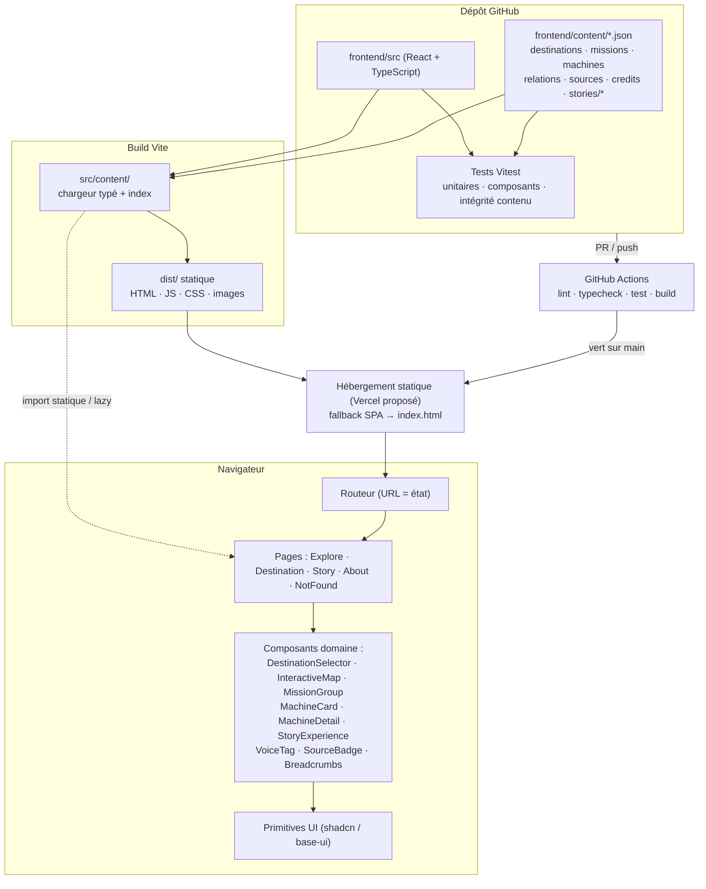
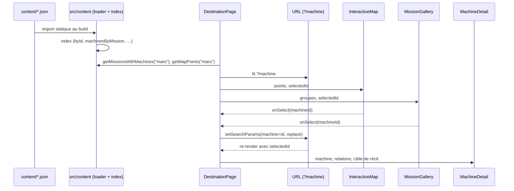
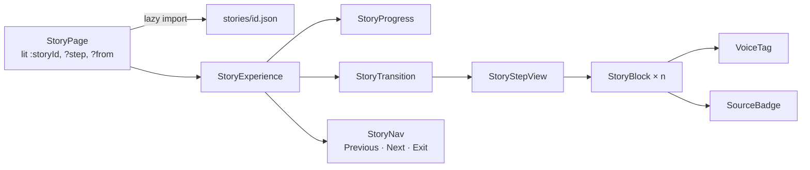

# Architecture — AeroReborn

> Rôle BMAD : Architect · Version 1.0 (Phase 0) · Statut : **en attente de validation**
> Décisions détaillées : [TECHNICAL_DECISIONS.md](TECHNICAL_DECISIONS.md) (ADR-xxx). Modèle de données : [DATA_MODEL.md](DATA_MODEL.md).
> Les éléments marqués *(proposé)* dépendent d'une décision `OPEN-xx` non encore validée.

## 1. Principes directeurs

1. **Frontend + API** (ADR-016) : le frontend React est une SPA ; une API Express en TypeScript (`backend/`) est disponible. Ce que l'API sert est en attente de **OPEN-18** ; d'ici là, aucune page ne dépend d'elle.
2. **Contenu ≠ code** : les faits vivent dans `frontend/content/*.json`, les composants ne contiennent aucune donnée scientifique.
3. **La galerie est le socle, la carte un enrichissement** : toute fonctionnalité doit marcher sans la carte (CDC §9 « plan de secours »).
4. **L'URL est la source de vérité** de la navigation et de la sélection : partageable, compatible bouton retour, testable.
5. **Le récit est indépendant de sa technique d'animation** (OPEN-10 reste ouvert sans bloquer le développement).
6. **Simplicité hackathon** : pas de store global, pas de librairie cartographique, pas de base de données, dépendances ajoutées uniquement si justifiées par un ADR.
7. **Aucun texte en dur** : toute chaîne visible passe par l'i18n (ADR-015).

## 2. Vue d'ensemble



## 3. Organisation des dossiers

On **conserve `frontend/` et `backend/`** (pas de réorganisation du dépôt). L'emplacement final de `content/` dépend d'OPEN-18.

```
aeroreborn/
├── CLAUDE.md                     Guide opérationnel des agents
├── README.md
├── .nvmrc                        Node 24
├── LICENSE
├── THIRD_PARTY_LICENSES.md       (phase 1, complété en phase 5)
├── .github/workflows/ci.yml      matrice frontend + backend
├── docs/                         product/ · architecture/ · design/ · quality/ · project/ · reference/
├── backend/                      API Express 5 + TypeScript
│   ├── src/app.ts                construit l'app (testable sans écouter un port)
│   ├── src/server.ts             point d'entrée (PORT, dotenv)
│   └── src/*.test.ts             Vitest + supertest
└── frontend/
    ├── content/                  ★ Contenu scientifique (JSON) — DATA_MODEL.md
    │   ├── destinations.json
    │   ├── missions.json
    │   ├── machines.json
    │   ├── relations.json
    │   ├── sources.json
    │   ├── credits.json          crédits non liés à un média (polices, libs, IA, équipe)
    │   └── stories/<storyId>.json
    ├── public/
    │   └── images/               médias autorisés, optimisés (WebP/AVIF)
    │       ├── destinations/
    │       ├── maps/             fonds de carte équirectangulaires
    │       └── machines/
    └── src/
        ├── main.tsx
        ├── app/                  App, router, Layout (header, nav, skip link), ErrorBoundary
        ├── pages/                ExplorePage · DestinationPage · StoryPage · AboutPage · NotFoundPage
        ├── components/
        │   ├── ui/               primitives shadcn / base-ui (Button…)
        │   ├── navigation/       SiteNavigation · Breadcrumbs · BackLink
        │   ├── destination/      DestinationSelector · DestinationCard · DestinationHeader
        │   ├── map/              InteractiveMap · MapMarker · MapLegend
        │   ├── gallery/          MissionGallery · MissionGroup · MissionJumpBar · MachineCard
        │   ├── machine/          MachineDetail · StatusBadge
        │   ├── story/            StoryExperience · StoryProgress · StoryStepView · StoryBlock · StoryNav · StoryTransition
        │   └── sources/          SourceBadge · SourceList · VoiceTag
        ├── content/              chargeur typé, index, accesseurs (getMachine, getMissionsByDestination…)
        ├── types/                content.ts (types du modèle de données)
        ├── lib/                  utils (cn), geo (projection, clustering), a11y helpers
        ├── hooks/                useSelectedMachine · usePrefersReducedMotion · useFocusOnChange
        ├── i18n/                 messages/en.ts · messages/fr.ts · I18nProvider · useTranslation (ADR-015)
        ├── styles/               tokens.css (design system COSMOS)
        └── test/                 setup.ts · fixtures/ (contenu factice pour tests de composants)
```

Règles : un composant par fichier ; un dossier de composants = un domaine ; `pages/` composent, `components/` affichent, `content/` et `lib/` ne dépendent jamais de React.

## 4. Routage et état dans l'URL

*(proposé — OPEN-04 : react-router, `createBrowserRouter`)*

| Route | Page | Paramètres d'état | Exigences |
|---|---|---|---|
| `/` | ExplorePage | — | DEST-001 → 005 |
| `/explore/:destinationId` | DestinationPage | `?machine=:machineId` (sélection + fiche ouverte), `#mission-:missionId` (ancre) | EXPL, EQUIP, MAP, SYNC |
| `/stories/:storyId` | StoryPage | `?step=1..6` (défaut 1), `?from=:machineId` (retour) | STORY-* |
| `/about` | AboutPage | `#source-:sourceId` | ABOUT-*, SOURCE-004 |
| `*` (et ids inconnus) | NotFoundPage | — | NAV-004 |

- `destinationId` invalide → NotFound. `machine` inconnu ou d'une autre destination → ignoré (fiche fermée), pas d'erreur.
- Changement de sélection : `replace` dans l'historique (éviter de polluer le retour) ; changement d'étape de récit : `push` (le bouton retour revient à l'étape précédente, US-4.2).
- Le fil d'Ariane est **dérivé** de la route + contenu (destination ← mission ← machine ← story), jamais stocké.

## 5. Composants et responsabilités

| Composant | Responsabilité | Entrées principales | Ne fait pas |
|---|---|---|---|
| `Layout` | Header, `SiteNavigation`, lien d'évitement « Skip to content », `<main>`, footer avec mention de non-affiliation | — | Logique métier |
| `SiteNavigation` | Liens Explore / About & Sources | route courante | — |
| `Breadcrumbs` | Fil d'Ariane accessible | segments dérivés | Calculer les segments (fait par `useBreadcrumbs`) |
| `DestinationSelector` | Les 2 `DestinationCard` | `Destination[]` | Naviguer (lien natif) |
| `DestinationCard` | Grande zone cliquable (`<a>` englobant), image, nom, compteurs optionnels | `Destination`, `counts?` | — |
| `DestinationPage` | Compose en-tête + carte + galerie + fiche ; lit/écrit `?machine` | `destinationId`, URL | Afficher les détails lui-même |
| `InteractiveMap` | Fond de carte SVG, marqueurs, légende, état sélectionné | `MapPoint[]`, `selectedId`, `onSelect` | Charger des données ; connaître les missions |
| `MapMarker` | `<button>` positionné, nom accessible, états | point, `selected` | — |
| `MissionGallery` / `MissionGroup` | Groupes par mission, ancres, mise en évidence, défilement | `MissionWithMachines[]`, `selectedId`, `onSelect` | — |
| `MissionScene` / `MachineJourney` / `MachineStage` (`components/journey/`) | Parcours scrollé de la page destination : photo de mission en fond, puis par machine une scène « sticky » (photo en faux 3D CSS qui entre, tourne, sort) et des chapitres tirés de la frise. Variables CSS écrites par `useSceneMotion` (pas de rendu React au scroll) ; sous mouvement réduit, images dans le flux et aucune animation | `MissionDetail` (photos + frise), `Machine` | Inventer du texte : tout vient de l'API (`lib/journey.ts`) |
| `MissionJumpBar` | Liens d'ancre vers les groupes | missions | Filtrer (P0) |
| `MachineCard` | Résumé d'un équipement | `Machine`, `selected` | — |
| `MachineDetail` | Panneau/dialog de détail, sources, relations, CTA récit, gestion du focus | `Machine`, `relations`, `storyTarget?` | — |
| `StatusBadge` | Statut = icône + libellé (+ couleur de renfort) | `MachineStatus` | — |
| `StoryExperience` | Orchestration : étape courante, progression, navigation, transitions | `Story`, `step`, `onStepChange`, `exitHref` | Connaître le routeur |
| `StoryProgress` | Liste ordonnée des 6 étapes, `aria-current="step"` | étapes, courant | — |
| `StoryStepView` / `StoryBlock` | Rendu d'une étape / d'un bloc avec voix, sources, média | `StoryStep` / `StoryBlock` | — |
| `StoryTransition` | **Seul** point où vit l'animation entre étapes ; neutre si mouvement réduit | `children`, `stepKey` | — |
| `VoiceTag` | Étiquette « Fact / What it means / Imagine » | `Voice` | — |
| `SourceBadge` / `SourceList` | Accès aux sources sans quitter la lecture / liste complète | `sourceIds` | — |
| `AboutPage` | Crédits, licences, IA, non-affiliation, sources | `credits`, médias, sources | — |

## 6. Circulation des données



- Le chargeur expose des **fonctions pures** et typées ; aucune page n'importe directement un JSON.
- Les relations et sources sont résolues par identifiant via l'index (O(1)).

## 7. Gestion des états

| État | Où | Pourquoi |
|---|---|---|
| Destination, équipement sélectionné, étape, origine du récit | **URL** | Partage, retour navigateur, deep-link démo |
| Contenu | Modules importés (immuables) | Statique, aucune synchronisation nécessaire |
| Carte repliée (mobile), popover de source ouvert, survol | État local du composant | Éphémère |
| Préférence de mouvement réduit | Media query CSS + hook `usePrefersReducedMotion` (pour `scrollIntoView`) | Accessibilité |

**Pas de store global** (Redux, Zustand…) ni de Context métier : la profondeur d'arbre est faible et l'URL suffit (ADR-008).

## 8. Fonctionnement de la carte

*(ADR-007)*

- **Fond** : image raster équirectangulaire (globale, 2:1) de la destination, réduite et optimisée, insérée dans un `<svg viewBox="0 0 360 180">` (OPEN-15 pour la source et la licence).
- **Projection** (fonction pure `lib/geo.ts`, testée) :
  - `x = lon + 180` ; `y = 90 − lat` dans le viewBox, avec `lon ∈ [-180, 180]` **est-positif** et `lat ∈ [-90, 90]`.
  - ⚠️ Mars : certaines sources expriment la longitude **ouest-positive** ou sur 0–360°. Les données sont **normalisées en est-positif [-180, 180]** à la saisie, et la convention d'origine est notée dans le champ `coordinates.note`. Le fond de carte doit être centré sur le même méridien (vérifié en US-3.3).
- **Marqueurs** : couche HTML superposée au SVG (conteneur `aspect-ratio: 2 / 1`), chaque marqueur est un `<button>` positionné en pourcentage (`left = x/360`, `top = y/180`). Avantages : taille tactile fixe ≥ 44 px indépendante de l'échelle, focus et sémantique natifs, tests faciles.
- **Regroupement de sites** : les points trop proches à l'échelle affichée (distance < taille d'un marqueur) sont fusionnés en un **marqueur de site** qui liste ses équipements (ex. équipements d'une même zone d'atterrissage). Fonction pure `clusterPoints(points, thresholdInViewBoxUnits)` testée.
- **Légende et honnêteté** : « Simplified map — positions are approximate » + crédit du fond (MAP-004).
- **Relations (P1)** : couche SVG de tracés avec `vector-effect: non-scaling-stroke`, chaque tracé doublé d'une liste textuelle.
- **Résilience** : `InteractiveMap` est enveloppé d'un `ErrorBoundary` ; en cas d'erreur, message + galerie seule (SYNC-003).
- **Pas de zoom/pan en P0.**

## 9. Synchronisation carte ↔ galerie

1. Les deux vues reçoivent le même `selectedId` (issu de l'URL) et le même `onSelect`.
2. `onSelect(id)` → `setSearchParams({ machine: id }, { replace: true })`.
3. Effet dans `MissionGallery` : quand `selectedId` change **suite à une sélection sur la carte**, `scrollIntoView({ block: 'nearest', behavior: reducedMotion ? 'auto' : 'smooth' })` sur la carte d'équipement.
4. `InteractiveMap` calcule l'état sélectionné du marqueur (ou du marqueur de site contenant `selectedId`).
5. Équipement sans coordonnées → aucun marqueur sélectionné, la fiche affiche « Location not mapped ».
6. La fiche (`MachineDetail`) se ferme en supprimant `machine` de l'URL ; le focus revient à l'élément déclencheur (ref mémorisée).

## 10. Système narratif

*(ADR-014)*



- Données : 6 étapes à clés fixes (`signal`, `why`, `how`, `discovery`, `relay`, `your-turn`), chacune composée de **blocs** typés par voix (`data`, `interpretation`, `imagination`). Voir DATA_MODEL §5.
- `StoryExperience` est **contrôlé** (`step` + `onStepChange`) et ignore le routeur → testable sans router, réutilisable pour une future mise en page « scroll ».
- **Navigation** : boutons Previous/Next, clic sur une étape de la progression, bouton retour du navigateur. Pas de raccourci clavier global en P0 (risque de conflit avec les lecteurs d'écran).
- **Focus** : à chaque changement d'étape, focus sur le titre de l'étape (`tabIndex={-1}`) et annonce via la région live implicite du titre.
- **Animation** : uniquement dans `StoryTransition`. P0 : fondu CSS court, supprimé sous `prefers-reduced-motion`. Le jour où OPEN-10 est tranché (scroll storytelling, parallax), on ajoute une **mise en page alternative** (`StoryScrollLayout`) qui consomme exactement les mêmes données et composants `StoryStepView` ; la mise en page pas-à-pas reste le repli.
- **Étape Relay** : affiche les relations référencées par `relationIds` avec « ce qui a été transmis » + preuve + source.
- **Fin** : `StoryNav` à l'étape 6 propose retour mission, équipements associés, autre destination (STORY-008).

## 11. Chargement des contenus

> **Mise à jour 2026-11-14 — le frontend lit le contenu depuis l'API (ADR-016, OPEN-18).** Le tableau ci-dessous (import statique) est remplacé :
> - `src/api/client.ts` : une fonction par route (`api.destination`, `api.mission`, `api.machine`, `api.story`, `api.sources`) ; base `VITE_API_BASE_URL` (vide en dev : proxy Vite `/api` → backend) ; `?lang=` = langue de l'interface.
> - `src/api/types.ts` : formes des réponses déjà localisées (miroir de `backend/src/content/types.ts`).
> - `src/hooks/useApi.ts` : chargement + annulation (AbortController) + rechargement au changement de langue, état `loading | success | error` et `retry()` ; aucune librairie ajoutée.
> - Chargement **à la demande** : la page destination charge `/destinations/:id` ; la chronologie (`/missions/:id`) et les photos/sources d'une machine (`/machines/:id`) ne se chargent qu'à l'ouverture du panneau.
> - Erreurs : composant `LoadState` (message clair + « Réessayer ») ; récit inconnu → message dédié (404).
> - Les ancres (`#mission-…`, `#machine-…`) sont résolues **après** chargement (retour « Quitter le récit » vers la machine d'origine, avec focus).
> - Médias : `MediaFigure` charge les fichiers depuis les serveurs NASA (ADR-017) avec `DepictionBadge` (MEDIA-001) ; YouTube, modèles 3D et PDF s'ouvrent sur leur page officielle (pas d'intégration tierce).

| Fichier | Mode | Justification |
|---|---|---|
| destinations, missions, machines, relations, sources, credits | Import statique (bundle principal) | Petits volumes (dizaines d'entrées), nécessaires dès la page destination |
| `stories/*.json` | `import.meta.glob(..., { import: 'default' })` **lazy**, un chunk par récit | Textes plus volumineux, chargés seulement à l'ouverture |
| Images | `public/images/`, `loading="lazy"` hors écran initial, `width`/`height` explicites | Performance, pas de layout shift |

Typage : les JSON importés sont convertis vers les types de `src/types/content.ts` dans le chargeur ; leur conformité est **garantie par le test d'intégrité** (DATA-003), pas par une validation runtime (pas de coût dans le bundle).

## 12. Styles et design system

- Tailwind v4 (déjà en place) + **tokens COSMOS** en variables CSS (`src/styles/tokens.css`) mappées dans `@theme` ([DESIGN_SYSTEM.md](../design/DESIGN_SYSTEM.md)).
- Thème **sombre unique** (pas de bascule clair/sombre en P0) : la palette COSMOS est conçue pour fonds sombres.
- Primitives shadcn/base-ui conservées pour les composants génériques (Button, Dialog/Sheet pour la fiche, Popover pour les sources) — elles apportent la gestion du focus et d'ARIA. Ajout de chaque primitive = justification dans la PR.

## 13. Accessibilité transverse

- Lien « Skip to content », landmarks (`header`, `nav`, `main`, `footer`), un `<h1>` par page, titre de document mis à jour à chaque route.
- Focus visible global (token `--focus-ring`), jamais `outline: none` sans remplacement.
- Statut, sélection, voix : texte + forme, couleur en renfort.
- `prefers-reduced-motion` respecté en CSS et dans les comportements JS (défilement).
- `lang="en"` (ou selon OPEN-06) sur `<html>`.

## 14. Stratégie de tests

| Niveau | Outil | Cible | Données |
|---|---|---|---|
| Unitaire | Vitest | `lib/geo` (projection, clustering), accesseurs `content/` | Fixtures |
| Intégrité contenu | Vitest (+ zod en devDependency, OPEN-17) | Tous les fichiers `content/` | **Contenu réel** |
| Composants / interactions | Vitest + Testing Library + user-event | Sélection destination, sync carte↔galerie, fiche (Échap, focus), navigation récit, SourceBadge | **Fixtures** (`src/test/fixtures`) pour ne pas dépendre de l'avancement du contenu |
| Accessibilité | Lighthouse (manuel) + checklist clavier | 4 pages | Build déployé |
| Smoke | Manuel, navigation privée | Parcours de démo | URL publique |

Pas d'E2E navigateur (Playwright) dans le MVP (ADR-012) ; à reconsidérer en P1.

## 15. Déploiement et CI

*(proposé — OPEN-05, ADR-013)*

- **CI** `.github/workflows/ci.yml` : déclenchée sur PR et push `main` ; `working-directory: frontend` ; Node 24 ; `npm ci` → `npm run lint` → `npm run typecheck` → `npm test` → `npm run build`.
- **Hébergement** : Vercel (projet lié au repo GitHub, racine `frontend`, build `npm run build`, sortie `dist`), réécriture SPA `/(.*) → /index.html` dans `frontend/vercel.json`. Déploiements de prévisualisation par PR.
- **Pas de variables d'environnement secrètes** : le site n'en a pas besoin.
- Déploiement du squelette **dès la phase 1** (US-1.7).

## 16. Backend

`backend/` : Express 5 en TypeScript (ADR-016). Routes actuelles : `GET /api/health` et un 404 JSON pour toute autre route `/api/*`. En développement, Vite redirige `/api/*` vers `http://localhost:3000` (`VITE_API_PROXY_TARGET` pour changer). 

**Contenu** : `backend/content/` (`destinations.json`, `missions.json`, `machines.json`, `relations.json`, `sources.json`, `media.json`, `stories/*.json`), chargé par `src/content/load.ts` (`$CONTENT_DIR` pour un autre dossier) et validé au démarrage par `src/content/validate.ts`. `npm run content:check` affiche toutes les erreurs et tous les avertissements.

**Contrat d'API** (lecture seule, JSON, `?lang=en` ou `?lang=fr`, anglais par défaut ; chaque objet `{ en, fr }` devient une chaîne) :

| Route | Réponse | Erreurs |
|---|---|---|
| `GET /api/health` | `{ status, message }` | — |
| `GET /api/destinations` | Destinations triées, avec `missionCount` et `machineCount` calculés | — |
| `GET /api/destinations/:id` | Destination + `missions[]` (triées) avec leurs `machines[]` et `mainStory` | 404 |
| `GET /api/missions/:id` | Mission + `timeline` (étapes datées, chacune avec ses `media` résolus), `machines`, `stories`, `relations`, `media` | 404 |
| `GET /api/machines/:id` | Équipement + `mission`, `destinationId`, `relations` (avec `fromEntity`/`toEntity` : `{ kind, id, name, destinationId }`), `media`, `storyTarget` (STORY-003), `sources` résolues (équipement **et** relations) | 404 |
| `GET /api/stories` | Résumés `{ id, title, status, missionIds }` | — |
| `GET /api/stories/:id` | Récit complet (6 étapes) + `destinationId`, `missions`, `machines` citées (`{ id, name, destinationId }`), `relations` (avec `fromEntity`/`toEntity`), `media` et `sources` utilisées | 404 |
| `GET /api/relations` | Toutes les relations documentées | — |
| `GET /api/sources`, `GET /api/sources/:id` | Sources | 404 |
| `GET /api/media?missionId=&machineId=&type=` | Médias filtrés (`type` : image, animation, video, 3d-model, document) | 400 si `type` inconnu |

Toute autre route `/api/*` renvoie `404 { error: "Not found" }`. Le statut `draft` ou `reviewed` des récits est exposé tel quel : le frontend doit signaler un récit non relu.

## 17. Extensibilité (hors MVP, sans surcoût aujourd'hui)

- Nouvelle destination : ajout d'une entrée `destinations.json` + fond de carte ; aucune modification de composant.
- Traduction FR : remplacer `i18n/en.ts` par un dictionnaire par langue ; les textes de contenu porteront un suffixe de langue (décision P2).
- Mise en page narrative scroll/parallax : nouveau layout consommant `StoryStepView`.
